<h1 align="center">ふと</h1>

  <b>「ふと開く」から、「ふと気づく」へ</b> 
  スマホを使う前に、ひと呼吸。使うかどうかを、自分で選ぶ iPhone アプリ

  <a href="https://futo-share.vercel.app/"><b>紹介サイト</b></a> ・
  <a href="https://futo-share.vercel.app/privacy">プライバシーポリシー</a>

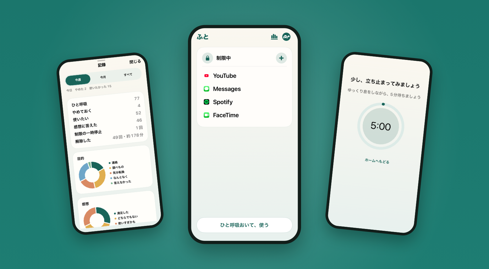

## 使い方

<table>
  <tr>
    <td align="center" valign="top">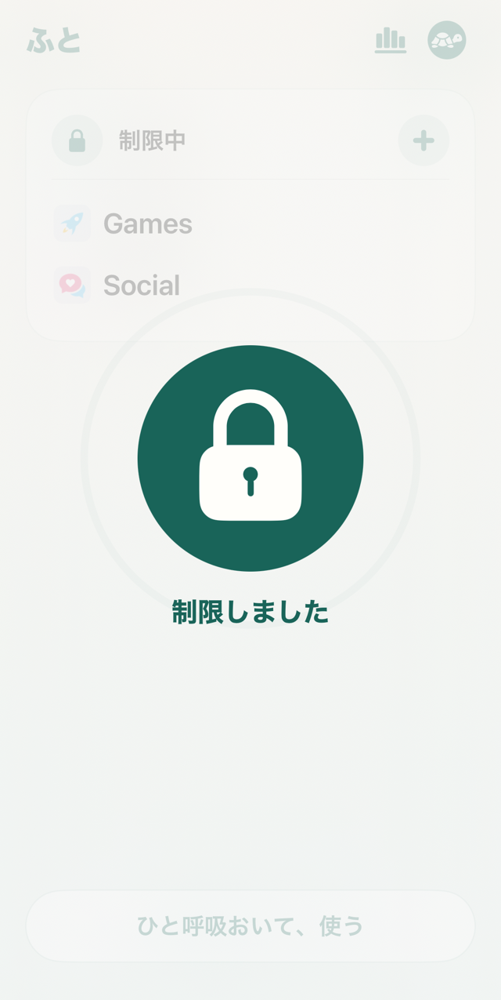 <b>1　ふだんは制限</b> 選んだものは ふだん使えません</td>
    <td align="center" valign="top"> <b>2　何をする？</b> 使いたくなったら 目的をひとつ選ぶ</td>
    <td align="center" valign="top"> <b>3　少し、立ち止まる</b> ゆっくり息をしながら 待つ</td>
    <td align="center" valign="top">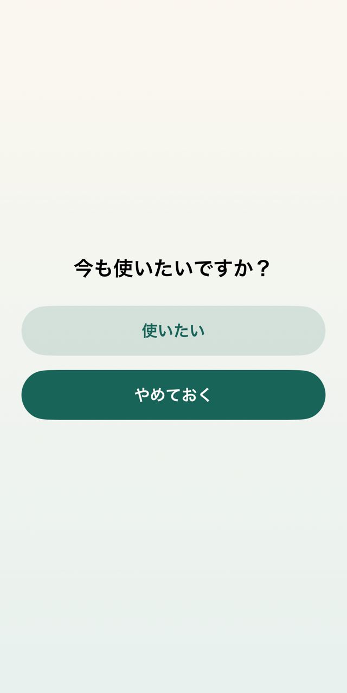 <b>4　自分で決める</b> 使うか、やめておくか</td>
    <td align="center" valign="top">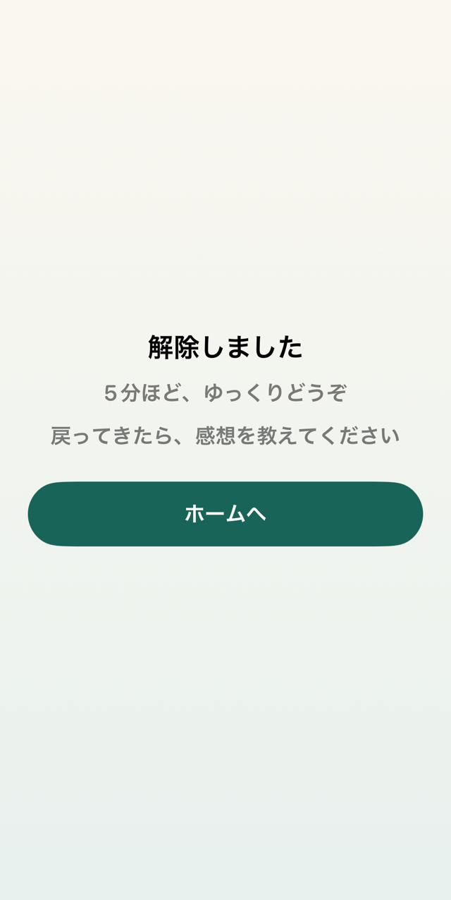 <b>5　自動で戻る</b> 時間が過ぎたら 制限に戻ります</td>
  </tr>
</table>

決めた時間が過ぎたら、自動で制限に戻ります。制限は、いつでも自分で外せます。

## 気づくための、記録

目的や感想を、やさしいグラフで。責めたり、競ったりはしません。

<table>
  <tr>
    <td align="center" valign="top">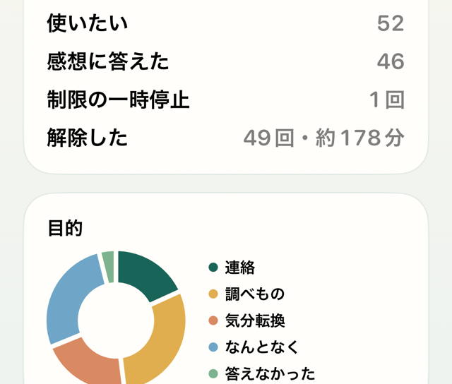 <b>いつ、何のために</b></td>
    <td align="center" valign="top">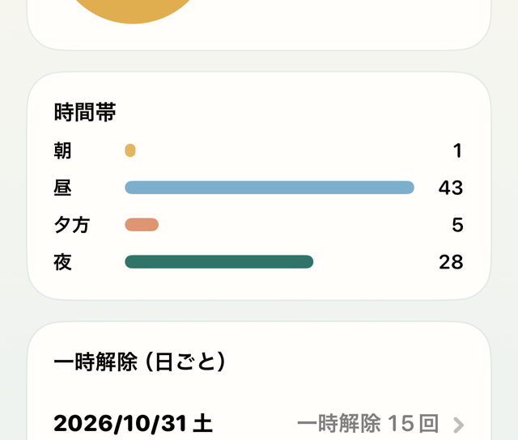 <b>時間帯と、日ごと</b></td>
    <td align="center" valign="top">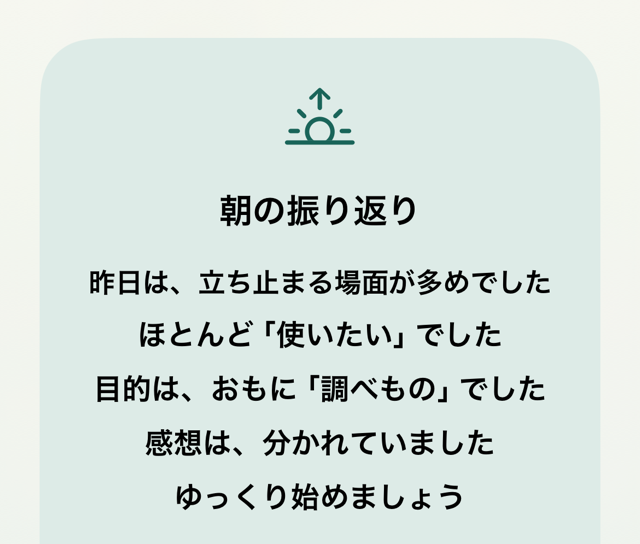 <b>朝と夜の、振り返り</b></td>
  </tr>
</table>

## 選んだものだけ、分かち合う

リンクやフレンドに、選んだ記録だけを。ログインは、使いたいときだけです。

<table>
  <tr>
    <td align="center" valign="top">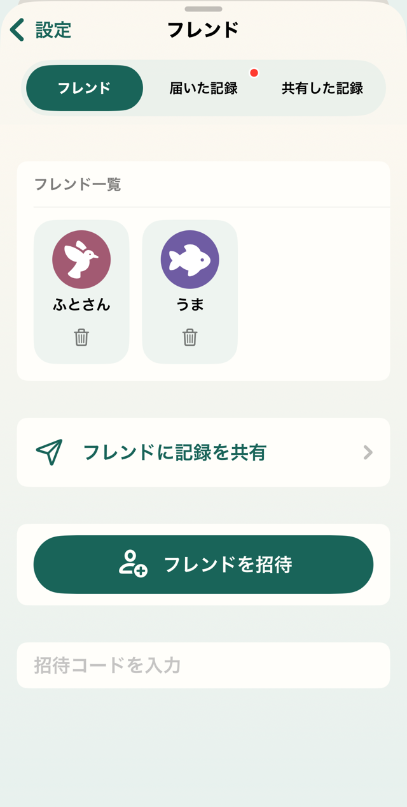 <b>フレンド</b></td>
    <td align="center" valign="top">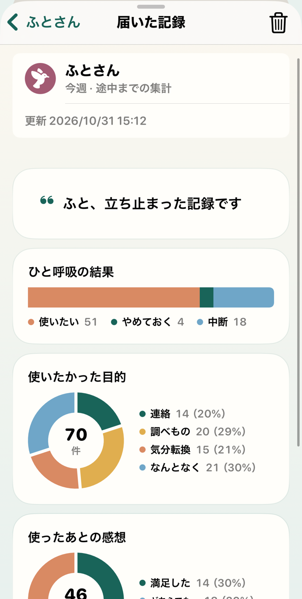 <b>届いた記録</b></td>
    <td align="center" valign="top">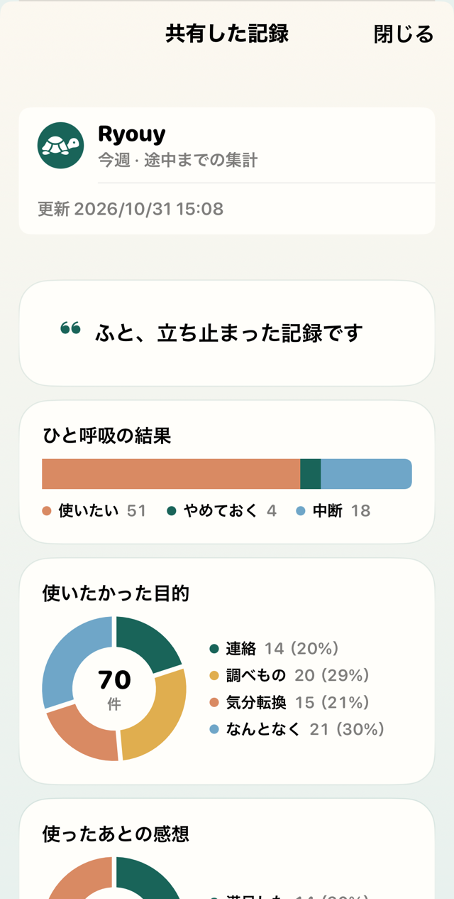 <b>共有した記録</b></td>
    <td align="center" valign="top">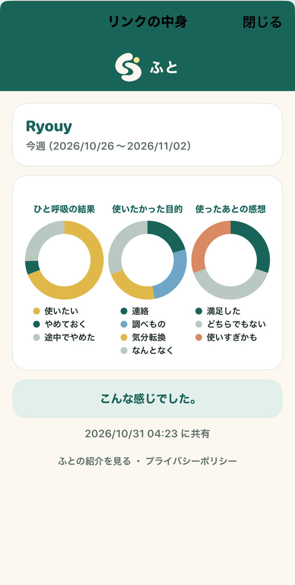 <b>リンクの中身</b></td>
  </tr>
</table>

## あなたの色で

4色のテーマと、好きな色。ダークモードと、日本語・English にも対応しています。

<table>
  <tr>
    <td align="center" valign="top">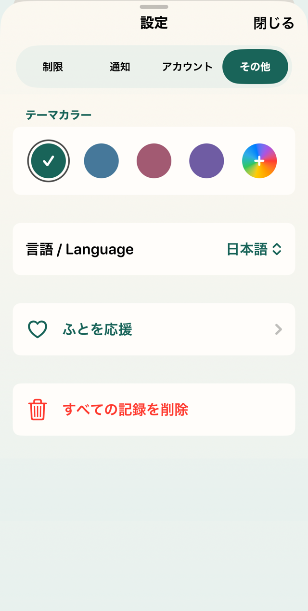 <b>テーマカラー</b></td>
    <td align="center" valign="top">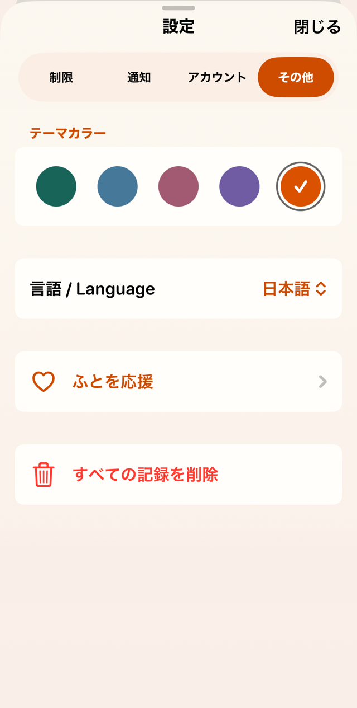 <b>好きな色</b></td>
    <td align="center" valign="top">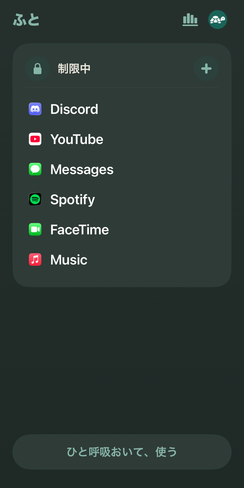 <b>ダークモード</b></td>
    <td align="center" valign="top">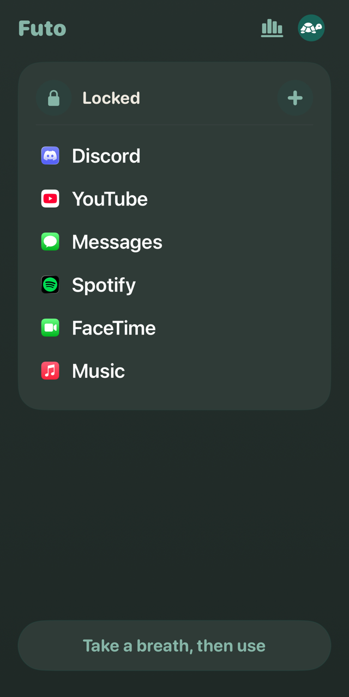 <b>English</b></td>
  </tr>
</table>

## iPad の横画面にも

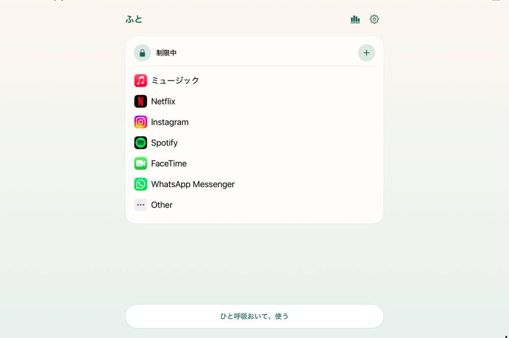

## 主な機能

**ログイン不要**

- アプリ・カテゴリ・サイトの制限と、時間を決めた一時解除
- 待ち時間を設けた、制限全体の一時停止・終了
- 目的や感想のグラフ、日ごとの解除回数
- 朝夜の振り返りと、任意の通知
- 日本語・英語対応、4色のテーマと、好きな色

**必要なときだけ、Google または Apple でログイン**

- **共有**：選んだ記録を、リンクやフレンドに共有
- **フレンド**：リンク・コード・QRで招待し、承認してつながる
- **バックアップ**：記録と設定をGoogle Driveのアプリ専用領域に保存（Googleとの接続が別に必要）

## そのほかの画面

<table>
  <tr>
    <td align="center" valign="top">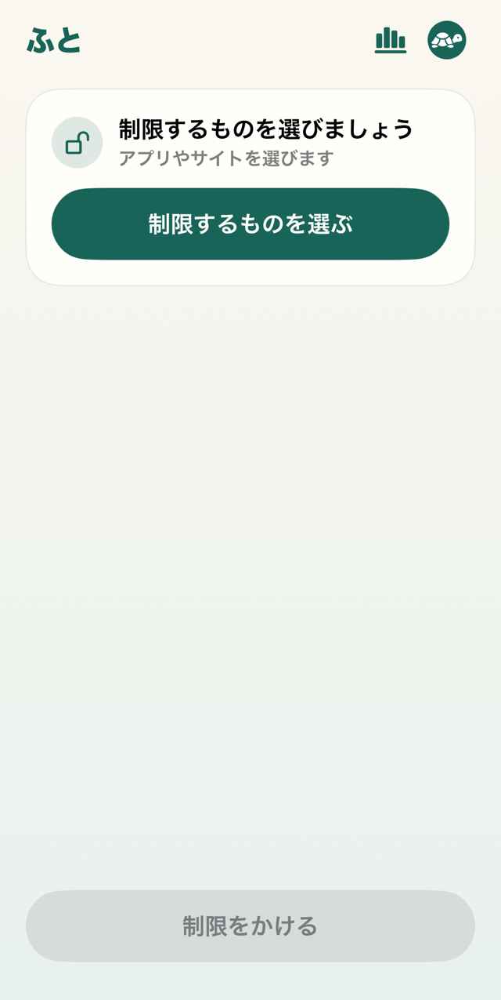 <b>はじめて</b></td>
    <td align="center" valign="top">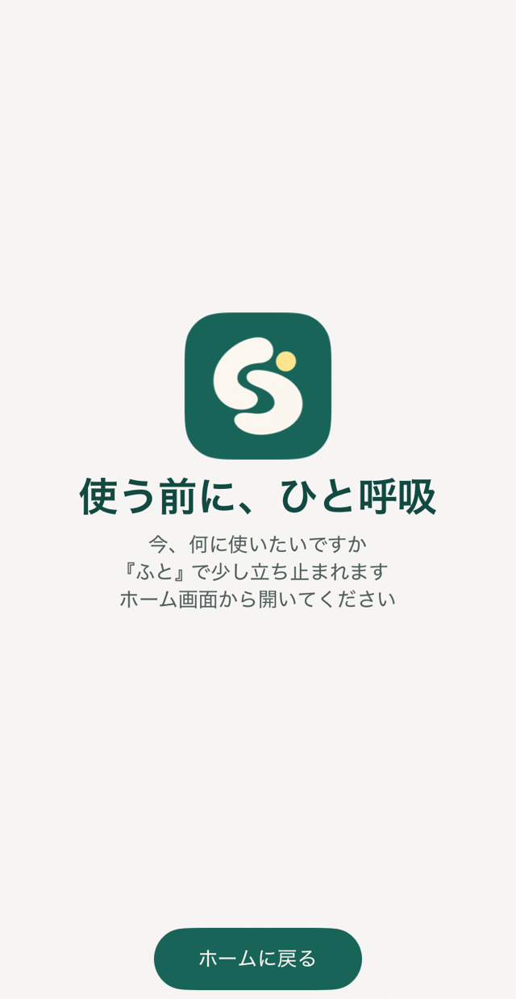 <b>制限の画面</b></td>
    <td align="center" valign="top">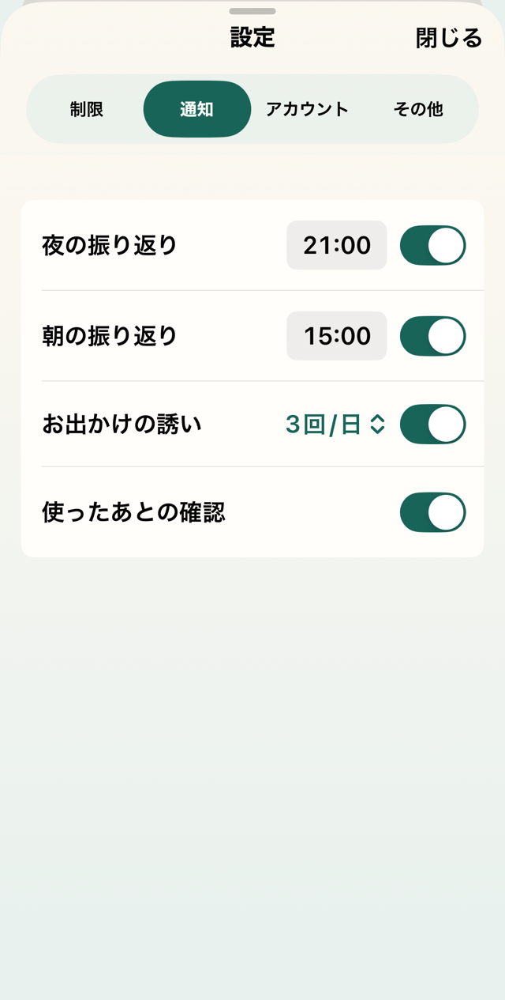 <b>通知</b></td>
    <td align="center" valign="top">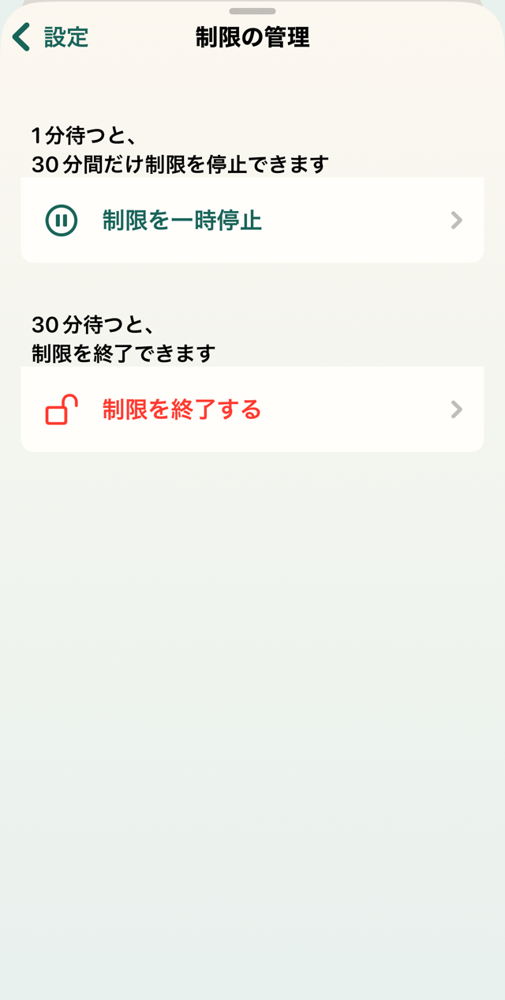 <b>制限の管理</b></td>
    <td align="center" valign="top">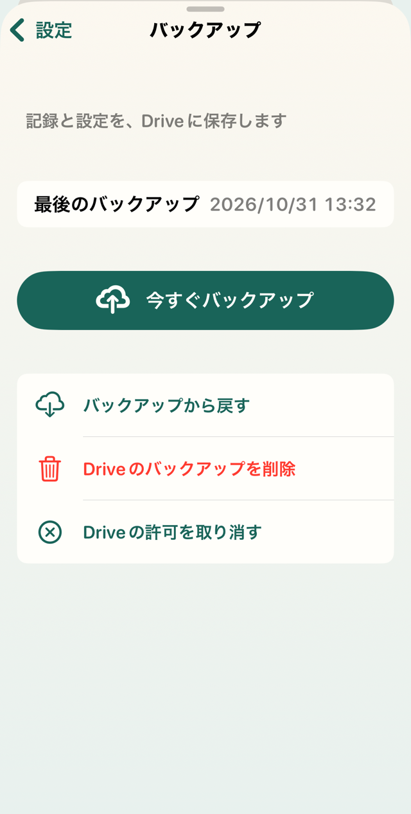 <b>バックアップ</b></td>
  </tr>
</table>
