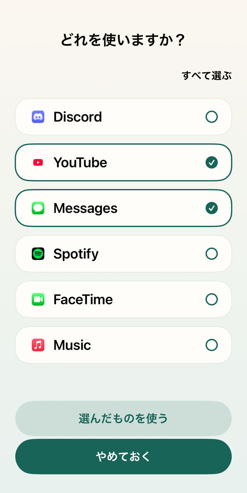
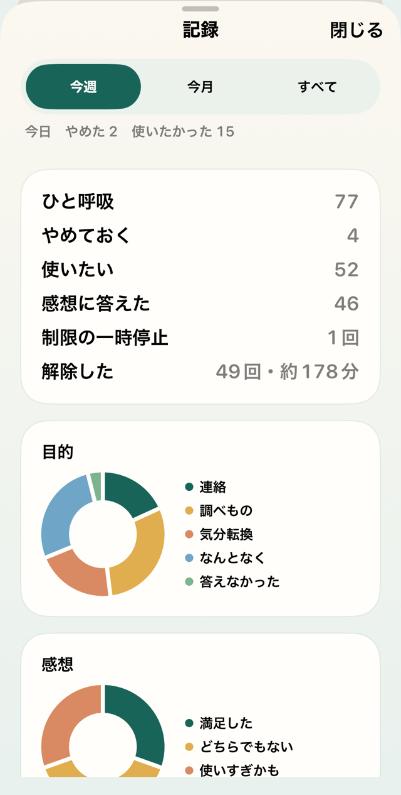
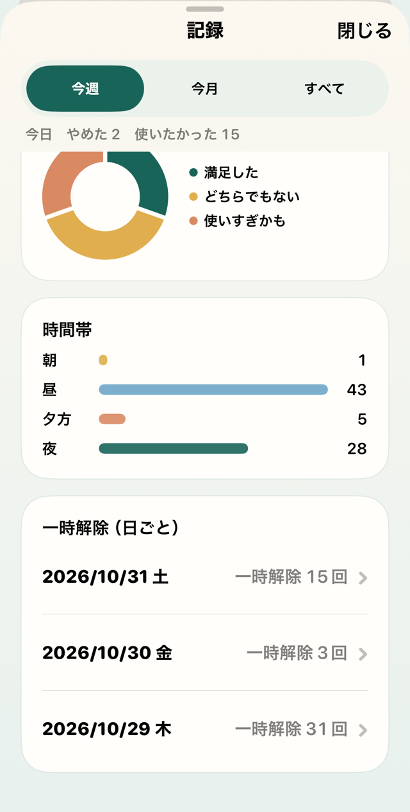
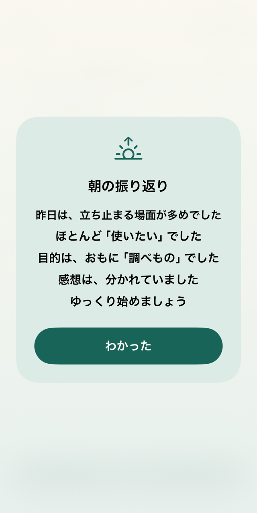
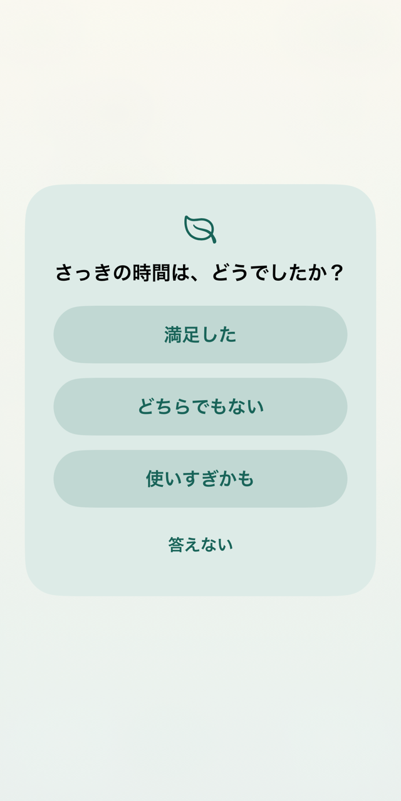
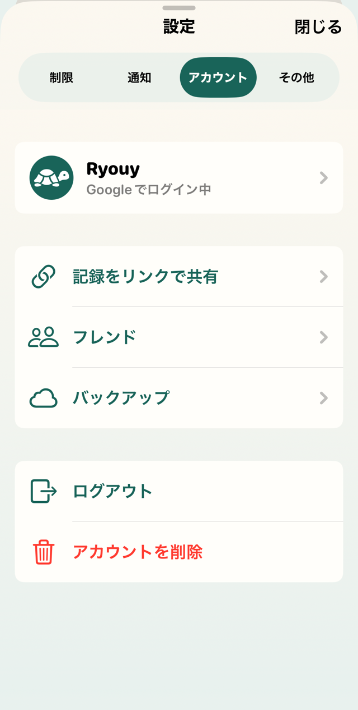
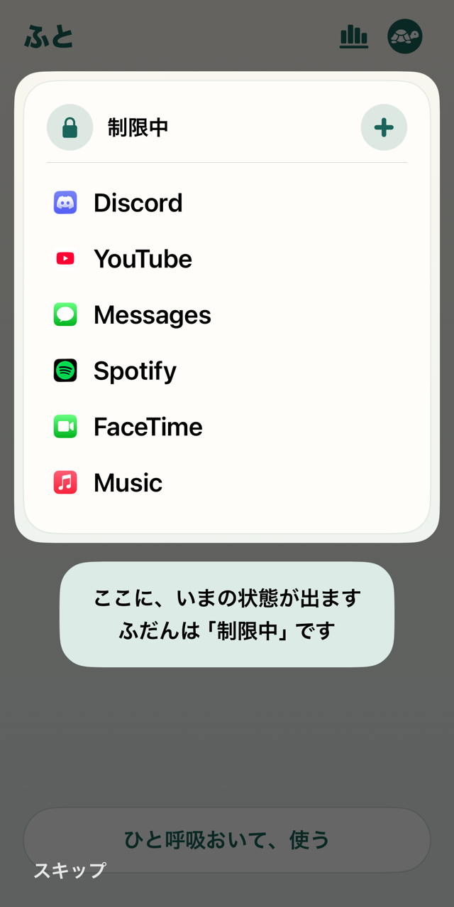
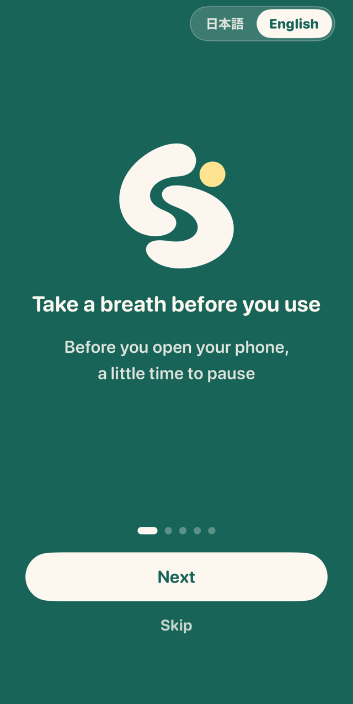
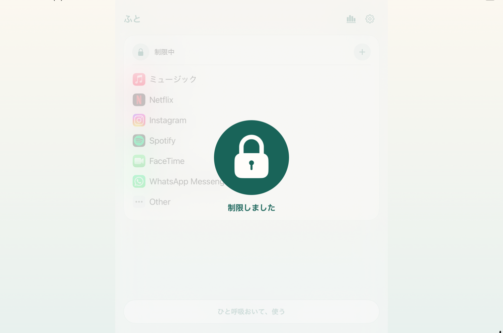
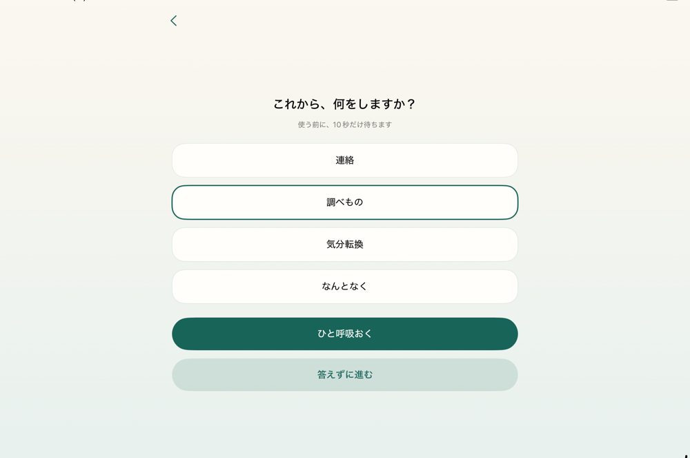

# ふと

**「ふと開く」から、「ふと気づく」へ**

スマホを使う前に、ひと呼吸  
使うかどうかを、自分で選ぶ iPhone アプリ

**[紹介サイト](https://futo-share.vercel.app/)**

<table>
  <tr>
    <td align="center"></td>
    <td align="center"></td>
    <td align="center"></td>
    <td align="center"></td>
    <td align="center"></td>
  </tr>
</table>

## 使い方

1. 制限するアプリやサイトを選ぶ
2. 使いたくなったら「ふと」で目的を選び、少し待つ
3. 使うか、やめておくかを選ぶ
4. 決めた時間が過ぎたら、自動で制限に戻る

## 主な機能

**ログイン不要**

- アプリ・カテゴリ・サイトの制限と、時間を決めた一時解除
- 待ち時間を設けた、制限全体の一時停止・終了
- 目的や感想のグラフ、日ごとの解除回数
- 朝夜の振り返りと、任意の通知
- 日本語・英語対応、4色のテーマと、好きな色

**必要なときだけ、Google または Apple でログイン**

- **共有**：選んだ記録を、リンクやフレンドに共有
- **フレンド**：リンク・コード・QRで招待し、承認してつながる
- **バックアップ**：記録と設定をGoogle Driveのアプリ専用領域に保存（Googleとの接続が別に必要）

## 画面

**使うとき**

<table>
  <tr>
    <td align="center"> 今も使いたい？</td>
    <td align="center"> どれを使う？</td>
    <td align="center"> 制限しました</td>
    <td align="center"> はじめて</td>
    <td align="center"> 制限の画面</td>
  </tr>
</table>

**記録と振り返り**

<table>
  <tr>
    <td align="center"> 記録</td>
    <td align="center"> 時間帯と日ごと</td>
    <td align="center"> 朝の振り返り</td>
    <td align="center"> さっきの時間は？</td>
  </tr>
</table>

**共有とフレンド**

<table>
  <tr>
    <td align="center"> フレンド</td>
    <td align="center"> 届いた記録</td>
    <td align="center"> 共有した記録</td>
    <td align="center"> リンクの中身</td>
    <td align="center"> アカウント</td>
  </tr>
</table>

**見た目と設定**

<table>
  <tr>
    <td align="center"> テーマカラー</td>
    <td align="center"> 好きな色</td>
    <td align="center"> ダークモード</td>
    <td align="center"> English</td>
    <td align="center"> 通知</td>
  </tr>
</table>

<table>
  <tr>
    <td align="center"> 制限の管理</td>
    <td align="center"> バックアップ</td>
    <td align="center"> はじめの案内</td>
    <td align="center"> English の説明</td>
  </tr>
</table>

**iPad（横画面）**

<table>
  <tr>
    <td align="center"></td>
    <td align="center"></td>
    <td align="center"></td>
  </tr>
</table>
